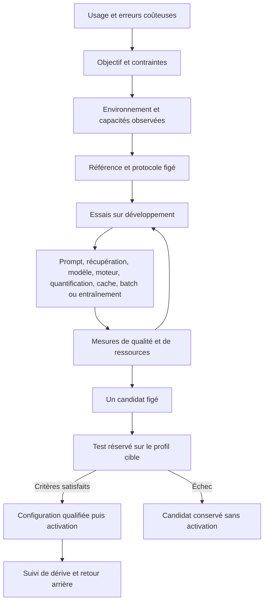

# AI Lab — système général d'optimisation

État au 11 novembre 2026, version 1.0.0. Le parcours livré relie une mission déclarée à une qualification locale, puis au transfert et à l’inférence. Enseigner une compétence et la transmettre reste un usage, parmi plusieurs stratégies d’amélioration. [Vérification 1.0](releases/2026-11-11-v1.md)

## Produit et promesse

AI Lab est le laboratoire d'un agent Hermes : il aide à choisir et vérifier une configuration pour une tâche, une charge et un environnement donnés. L'utilisateur décrit le résultat souhaité ; Hermes recueille les contraintes manquantes, puis utilise les outils du plugin pour inspecter, expérimenter et présenter les preuves.

Promesse cible : **« Donne à ton agent un laboratoire pour améliorer ses capacités et son exécution, avec des gains vérifiés. »** Une configuration peut contenir un modèle, un prompt, une politique de récupération, un seuil de décision, des réglages d'inférence ou un adaptateur entraîné. Le résultat n'est donc pas nécessairement un nouveau modèle.

« Optimiser au maximum » signifie chercher le meilleur candidat mesuré dans le périmètre et le budget convenus. Une latence plus basse ne compense pas une qualité insuffisante ou une contrainte obligatoire violée. Plusieurs candidats peuvent rester utiles parce qu'ils échangent qualité, délai et ressources : le produit doit montrer ce compromis plutôt que fabriquer un classement universel.

Le premier utilisateur est un développeur ou une petite équipe avec des tâches répétées et un modèle local. L'intérêt pour une grande entreprise dépendra de mesures sur ses tâches, ses erreurs coûteuses, son trafic et ses règles de données. Aucun client ni workload d'entreprise n'est encore validé.

## Parcours général

L'état doit distinguer contrat incomplet, références non vérifiées, référence mesurée, protocole figé, exploration, candidat figé, qualification et activation. Une commande exécutée avec succès ne prouve pas la qualité du résultat. Un test qui a guidé une modification ne reste pas un test indépendant.

### 1. Comprendre l'usage

Recueillir la tâche et la sortie attendue, la langue, les erreurs coûteuses, la fréquence de changement des connaissances et l'évaluateur. Caractériser les longueurs d'entrée/sortie, les requêtes simultanées, le mode interactif ou batch, le streaming et les préfixes récurrents.

Les objectifs chiffrés viennent du besoin. Une valeur inconnue reste à préciser. Le plugin ne doit pas inventer une précision acceptable, un budget cloud, une disponibilité matérielle ou une performance cible. L'interface conversationnelle pose quelques questions prioritaires, sans exiger que l'utilisateur connaisse les hyperparamètres.

### 2. Comprendre l'environnement

Distinguer matériel déclaré, matériel observé, exécutable présent, service joignable, modèle réellement chargé et génération vérifiée. Sur le Mac, la mémoire unifiée installée n'est pas la mémoire disponible. Sur NVIDIA, relever aussi architecture CPU, capacité de calcul, pilote, VRAM et topologie avant de choisir des kernels ou du parallélisme.

Le même contrat doit couvrir Apple Silicon, RTX, RTX Blackwell, DGX Spark et systèmes de datacenter, mais la compatibilité et les mesures appartiennent à chaque cible. Le profil matériel actuel est un inventaire, pas une certification de moteur. Le PC RTX 4070 n'est pas connecté ; aucun serveur ou GPU loué n'est créé par cette tranche.

### 3. Établir une référence crédible

Comparer à la solution actuelle et à une méthode simple adaptée. Exemples : règles et validation de schéma pour une extraction, modèle initial avec seuil calibré pour une classification, récupération lexicale avec générateur fixe pour une base documentaire. La calibration fait partie des candidats déclarés avant le test final.

Figer exemples, évaluateur, erreurs prioritaires, seuils, versions de modèle/tokenizer/template/runtime et protocole de mesure. Optimiser sur train/dev ; réserver des cas qui ne servent pas à la sélection. La qualification doit porter sur le résultat utile et les ressources du parcours, pas seulement sur un score de modèle isolé.

### 4. Choisir quoi modifier

| Problème à vérifier | Essais possibles | Contreparties à mesurer |
| --- | --- | --- |
| Sortie mal structurée ou consigne mal suivie | Règles, schéma, prompt et exemples | Erreurs de champs, entrées plus longues, régressions |
| Mauvais seuil de décision | Calibration et abstention sur dev | Fausses acceptations, faux rejets, couverture |
| Faits manquants ou périmés | Recherche, index et politique de contexte | Rappel des preuves, citations, fraîcheur, latence |
| Réponse trop lente à commencer | Contexte, préremplissage, cache de préfixe, moteur | TTFT, qualité, cache et mémoire |
| Génération ou traitement trop lent | Modèle, moteur, kernels compatibles, batching ; spéculation si compatible | Décodage, débit utile, file d'attente, latence sous charge |
| Mémoire insuffisante | Modèle plus petit, quantification des poids/cache, limites de contexte | Qualité, débit, recomputation et mémoire réelle |
| Erreurs de capacité persistantes | Données ciblées, LoRA/autre recette compatible | Gain indépendant, régressions, temps et coût d'entraînement |
| Agent lent ou peu fiable | Outils, récupération, routage, nombre d'appels et politique de reprise | Réussite de tâche, durée complète, erreurs d'outils, reprises |

Ces lignes sont des hypothèses d'essais, pas des diagnostics automatiques. Les optimisations peuvent interagir : une petite précision peut ralentir un kernel inadapté, un batch augmenter l'attente, un cache perdre son intérêt si les préfixes changent. Le registre doit conserver la configuration complète et les conditions du résultat.

Les documentations primaires illustrent ces compromis : vLLM décrit des réglages de préremplissage qui influencent différemment premier token, latence entre tokens et débit ; MLX-LM distingue cache de prompt, cache KV rotatif et taille des étapes de préremplissage, avec des effets sur mémoire, vitesse et qualité. Ces capacités documentées ne sont pas toutes exposées ou vérifiées par AI Lab. [vLLM — Optimization and Tuning](https://docs.vllm.ai/en/latest/configuration/optimization/) · [MLX-LM — Long Prompts and Generations](https://github.com/ml-explore/mlx-lm#long-prompts-and-generations)

### 5. Mesurer, retenir et transmettre

Mesurer la qualité avant de classer les configurations admissibles. Distinguer premier token, temps entre tokens, durée de génération et durée complète de tâche, en précisant tokenisation, réseau et outils inclus ou exclus. Le batch se juge aussi sur le débit de résultats acceptables ; l'agent sur la tâche terminée, ses reprises et ses échecs.

Mesurer sous la charge cible, avec plusieurs répétitions, des longueurs représentatives, une politique d'arrivée décrite, et des caches froids/chauds séparés. Conserver poids, cache et RSS comme compteurs de portées distinctes. Un petit relevé de six appels ne prouve ni un SLA p95 ni une performance multi-utilisateur.

Pour le coût, déclarer devise, périmètre et source des tarifs. Distinguer dépense externe et coût total estimé incluant énergie et matériel. Le contrôleur MLX borne aujourd’hui la durée, les essais et les tokens générés. Une mission locale déclare zéro dépense externe. Les limites de facturation distante dépendent de mécanismes à vérifier auprès du fournisseur.

Le paquet 1.0 inclut les réglages d’inférence, les empreintes, un résumé de preuve et l’adaptateur éventuel. Le destinataire fournit les poids de base correspondants et requalifie la configuration sur son profil. Activation et retour arrière sont propres au profil. [Format et commandes](registry.md)

## Livré dans la version 1.0

- **Préparation locale**. `ai_lab_mission` associe une mission complète à un protocole borné et à une demande de lancement. Les seuils et budgets viennent de l’opérateur. Les variantes changent un paramètre déclaré, à partir d’une référence explicite. Le profil expose les prérequis via `setup --check`. [Mission](mission.md)
- **Qualification MLX séquentielle**. `ai_lab_optimize` compare les variantes locales avec un correcteur JSON ou texte exact, décide sur le développement et vérifie les finalistes sur le test réservé. Le mode développement sert à la présélection. Le contrat du rapport sépare exécution, configuration acceptée et gain vérifié. [Contrôleur](controller.md)
- **Registre par profil**. `capture` attache la configuration acceptée au reçu du job et à ses empreintes. `activate`, `generate`, `result` et `rollback` permettent d’utiliser la configuration évaluée et de revenir à l’état précédent. `export` et `import` transfèrent un paquet portable. Le profil de destination doit requalifier la configuration avant de l’activer. [Registre](registry.md)
- **Distribution et observabilité**. L’archive installe le plugin et le skill `ai-lab:workflow`. Le wheel fournit le CLI et les interfaces MCP et HTTP locales. `mlx.train` expose les fréquences de pertes, de validation et de checkpoints. [Installation](../README.md)
- **Preuve locale**. Deux profils ont conservé leur référence sur une tâche synthétique de copie JSON. L’adaptateur a été transféré, requalifié, activé et utilisé en génération. Les deux profils sont revenus à leur état précédent. Une campagne refusée et un import non qualifié ont été bloqués par le registre. La tâche de copie et l’entraînement court prouvent le fonctionnement du parcours. Les résultats PAWS gardent leur verdict non qualifié. [Rapport 1.0](releases/2026-11-11-v1.md) · [Campagne PAWS 0.7](experiments/2026-11-09-lora-improve.md)

## Historique de la version 0.6

- **`ai_lab_analyze` / `hermes ai-lab analyze`** : contrat générique strict, inventaire local passif, inconnues et questions prioritaires, références simples, leviers conditionnels, métriques adaptées et critères de comparaison. Aucun modèle chargé, réseau sondé ou entraînement lancé par cette analyse. `plan_ready` signifie que la déclaration est complète ; les références restent à vérifier et aucune configuration n'est qualifiée.
- **`ai_lab_benchmark` / `hermes ai-lab benchmark`** : job MLX local, modèle existant, chat ou texte brut, un appel à la fois, échauffement séparé et répétitions. Chronométrage des tokens, traces et empreintes, mémoire active/cache/RSS distinguées. Limite de 900 s, huit prompts au plus, 2–10 répétitions, 256 tokens de sortie par appel au plus, et 8 192 tokens générés au total échauffement inclus. Chaque entrée est bornée à 8 192 octets UTF-8 et 2 048 tokens après formatage. La qualité et le gain d'optimisation ne sont pas évalués par cet outil seul.
- **`ai_lab_optimize` / `hermes ai-lab optimize`** : recherche finie parmi 1–8 variantes locales MLX, avec mesures de qualité et performance sur les mêmes réponses. Modèle, prompt, adaptateur, format d'entrée, limite de sortie et étape de préremplissage explicites. Deux à cinq répétitions, budgets de durée et tokens contrôlés, contraintes globales et par tranche. Choix sur dev, sélection figée avant lecture des références finales, puis test de la seule référence et du candidat choisi. Correction par JSON exact ou texte exact ; pas d'évaluateur sémantique universel. Le résultat peut refuser toutes les variantes. [Contrat et utilisation](../docs/controller.md).
- **Socle précédent conservé** : 21 opérations déclarées, jobs persistants, profils, deux protocoles d'apprentissage figés et mêmes interfaces Hermes/CLI/MCP/HTTP. La surface comprend 19 outils natifs.
- **Sortie JSON finie et comparaison pré-déclarée** : la version 0.6 masque la génération pour choisir parmi des objets JSON déclarés et vérifie le flux réellement émis. `holdout_candidate_id` fixe la paire avant les essais ; son évaluation finale ne dispense pas des seuils de qualification sur les deux jeux. La base corrigée et le LoRA obtiennent 44/64 et 53/64 sur le test réservé, tous deux avec 100 % de JSON valides. Le LoRA échoue encore en développement : pas de qualification globale. [Résultats et limites](experiments/2026-11-09-json-comparison.md).
- **Preuves** : trois exemples de contrats passent réellement par Hermes ; une demande incomplète retourne les inconnues ; six générations ont été mesurées sur le Mac avec le Qwen existant. [Rapport de vérification](experiments/2026-11-09-inference-profile.md).

Les anciennes expériences restent historiques : [triage](experiments/2026-11-09-triage-v1.md), où la méthode classique gagne ; [PAWS](experiments/2026-11-09-pair-paraphrase-v1.md), où le LoRA apporte un signal mais manque la qualification du destinataire. Leurs tests finaux sont consommés.

## Lots suivants

1. **Qualifier une tâche réelle**. Choisir des exemples représentatifs, une référence simple, des erreurs coûteuses et un nouveau test indépendant. Comparer des variantes déclarées avec les seuils de l’usage.
2. **Étendre les évaluateurs et leviers**. Traiter les tâches d’agent, la récupération documentaire, la calibration et la contrainte par schéma. Chaque nouveau levier demande des mesures adaptées à l’usage.
3. **Évaluer l’inférence en service**. Ajouter des mesures côté client, des essais sous charge, une politique de cache contrôlée et des seuils de réussite de tâche.
4. **Valider les autres moteurs et matériels**. Reprendre le protocole sur la RTX 4070 une fois accessible, puis sur les cibles disponibles. Les preuves CUDA, réseau, kernels et fournisseurs restent à établir. Le contrôleur et le registre de qualification 1.0 utilisent MLX local.
