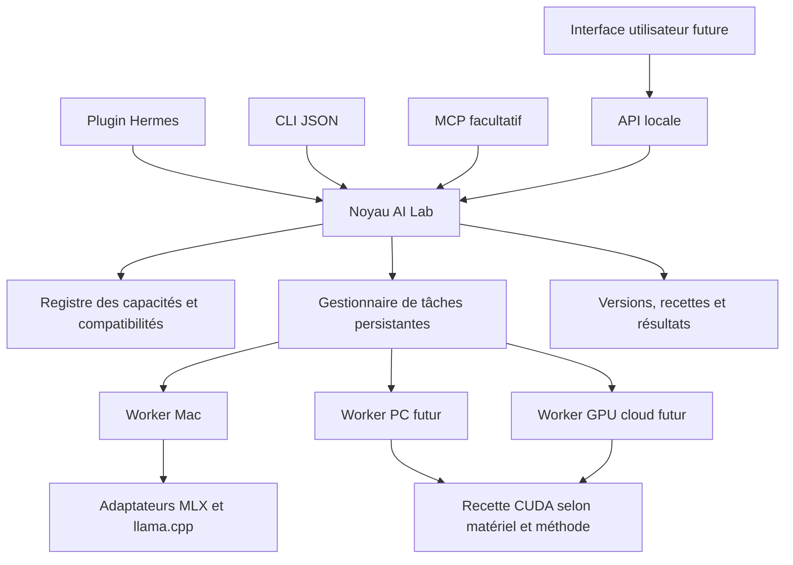

# AI Lab — architecture des connexions

État de réalisation au 9 novembre : voir [STATUS](../STATUS.md). Le socle est désormais implémenté avec SQLite et worker détaché partagé, sans socket Unix ; 14 outils/21 opérations, CLI/MCP/API. Ce document conserve aussi le périmètre produit futur, qui ne constitue pas une liste de capacités toutes validées.

Date : 8 novembre 2026. Statut : proposition technique, distincte des capacités installées. Demande actuelle : réfléchir au produit complet avant de poursuivre la construction. Périmètre d'exécution autorisé pour la première connexion : Mac uniquement.

Exigence précisée ensuite par Kais : architecture d'entraînement multi-matériels dès le socle, notamment RTX PRO 6000 Blackwell et DGX Spark. Le Mac est le premier profil à qualifier en exécution, pas la limite architecturale. Les choix détaillés et niveaux de preuve sont dans [hardware-training-architecture.md](hardware-training-architecture.md).

## Résultat attendu

L'utilisateur donne un modèle, un objectif, quelques tâches représentatives et ses ressources. AI Lab doit pouvoir préparer les données, transformer le modèle, mesurer le résultat et fournir une version utilisable par son agent, avec sa recette et ses limites. Une connexion n'est complète que lorsque son résultat peut être consommé par l'étape suivante.

Le premier périmètre produit porte sur les modèles de langage texte. Les modèles multimodaux exigent des contrats supplémentaires pour les données, les processeurs et les évaluations ; leur prise en charge ne découle pas automatiquement de celle des poids texte.

Ce document n'annonce aucune nouvelle installation, aucun téléchargement de poids, aucun entraînement et aucune connexion de compte cloud. Les lectures documentaires ne prouvent pas le fonctionnement de ces intégrations chez Kais.

## Une seule logique, plusieurs points d'entrée

Le noyau décide et enregistre ; les workers exécutent ; les adaptateurs traduisent une opération vers une bibliothèque, une commande ou une API. Les gros fichiers circulent entre stockage et workers : pas dans les réponses MCP ou dans le contexte du modèle.

| Interface | Rôle proposé | Priorité |
| --- | --- | --- |
| Plugin Hermes natif | Appeler le noyau via le SDK déjà vérifié ; retourner des résultats structurés et des identifiants de tâches. | Maintenant. |
| Notre CLI | Mêmes opérations, sortie JSON, exécution reproductible et diagnostic sans LLM. Le CLI actuel ne fait que de la découverte. | Maintenant. |
| Service de jobs local | Instance unique par workspace sur le Mac, jointe par socket Unix ; posséder les processus longs et retrouver leur état après fermeture du chat. | Prochain lot. |
| Notre API HTTP | Interface du service pour le panneau et, plus tard, d'autres clients. Liaison loopback authentifiée ; aucun accès réseau distant implicite. | Quand un client HTTP en a besoin. |
| Notre MCP | Exposer les mêmes capacités à d'autres agents. D'abord stdio pour un usage local ; HTTP distant demande un contrat d'accès distinct. | Après le parcours Hermes fonctionnel. |

MCP n'est pas le moteur d'entraînement. Ses tâches longues sont encore expérimentales dans la spécification consultée : le gestionnaire de jobs AI Lab reste indépendant. Le premier MCP pourrait donc retourner un `job_id`, avec des outils de consultation et d'annulation ; ajouter le mécanisme Tasks si le client le négocie. [Spécification MCP Tasks](https://modelcontextprotocol.io/specification/2025-11-25/basic/utilities/tasks).

## Carte des connexions

« Base » signifie déjà vérifié dans le projet, « prochain » une intégration à construire sur Mac, « extension » une capacité prévue mais non connectée.

| Capacité | Connexion réutilisée | Ce qu'AI Lab doit prendre en charge | État / ordre |
| --- | --- | --- | --- |
| Trouver les modèles et le matériel | Métadonnées HF, fichiers configurés, exécutables et endpoints locaux | Inventaire avec preuves : installé, joignable, modèle chargé, génération réussie sont des états distincts. | Base, partielle. |
| Acquérir un modèle | SDK `huggingface_hub`, import d'un dossier local | Résoudre une révision, sélectionner les fichiers utiles, estimer la place, télécharger, vérifier les shards et enregistrer l'origine. Accès privé séparé. | Prochain. |
| Préparer les données | JSONL local, puis HF Datasets/Parquet | Valider le schéma, rendre les messages avec le bon template, séparer train/validation/test, dédupliquer et conserver provenance et empreintes. | Prochain. |
| Apprendre à partir d'usages Hermes | Export explicite de sessions et hooks du SDK installé | Import ciblé, filtrage des secrets, qualification des réussites/échecs, séparation des données d'entraînement et d'évaluation. | Prochain pour les runs de démonstration ; historique privé sur sélection. |
| Exécuter sur le Mac | Processus locaux, environnements Python et binaires existants | Worker avec annulation, logs, checkpoints, limites de ressources, versions d'outils et exclusivité GPU/mémoire par défaut. | Prochain, indispensable. |
| Quantifier les poids | Convertisseur HF→GGUF, `llama-imatrix`, `llama-quantize` | Chaîne compatible, calibration facultative distincte du test, sortie immuable, vérification de chargement et comparaison qualité/mémoire/temps. | Première transformation. |
| Adapter un modèle sur Mac | MLX-LM : conversion, LoRA/QLoRA, fusion | Générer la recette, valider données/base, suivre l'apprentissage, enregistrer adapter/checkpoints et recharger le résultat. | Après la chaîne de quantification. |
| Adapter sur CUDA | Unsloth ; route portable TRL/PEFT/Accelerate ; NeMo pour recettes spécialisées | Sélectionner recette, environnement CPU/GPU, précision et topologie ; LLaMA-Factory reste une alternative. | Contrats dès le socle ; exécution NVIDIA à qualifier. |
| Personnaliser une méthode | Worker Python PEFT/TRL ; recette versionnée | Environnement séparé, entrées/sorties explicites, validation et métriques communes. Pas d'exécution arbitraire automatique comme interface par défaut. | Extension experte. |
| Générer des données / distiller | Endpoint enseignant local ou distant | Budgets, réponses versionnées, contrôle qualité. Pour la distillation interne : backend offrant effectivement les états/logits nécessaires. | Extension ; API fermée insuffisante pour les états internes. |
| Utiliser le résultat en local | `llama-server` d'abord ; serveur MLX selon format ; Ollama en option | Démarrer/arrêter nos processus, contrôler le chargement, tester génération/template/outils, fournir l'adresse au consommateur. | Prochain. Ollama est seulement sondé actuellement. |
| Mesurer le modèle et l'agent | Tâches Hermes instrumentées ; lm-evaluation-harness pour benchmarks compatibles | Baseline figée, répétitions, graders et tâches versionnés, résultats bruts, qualité, erreurs d'outils, latence et mémoire. | Prochain, requis avant toute revendication de gain. |
| Utiliser le PC personnel | SSH et worker local au PC ; tunnel existant si nécessaire | Détecter OS/GPU/VRAM, installer un environnement ciblé, transférer les entrées, lancer, suivre, annuler et récupérer les artefacts. | Extension. Aucune connexion PC maintenant. |
| Louer du calcul | API officielle Runpod Pods proposée en premier | Prévision, création idempotente/réconciliable, suivi, logs, collecte, arrêt et nettoyage. Les ressources de stockage ont leur propre cycle. | Extension payante, non provisionnée. |
| Conserver et transférer | Dossiers locaux + registre SQLite ; plus tard HF Hub, GCS ou S3 | Versions, manifestes, empreintes, reprise de transfert, permissions et références de secrets. Un stockage distant suffit au premier parcours cloud. | Local prochain, distant extension. |
| Héberger et distribuer | Endpoint local, export de dossier/GGUF ; plus tard HF Endpoints ou Runpod Serverless | Contrat de déploiement, contrôle de santé/génération, bonne version du modèle, retour à la version précédente et retrait propre. | Local prochain ; public/cloud extension. |
| Piloter des expériences | Recettes et configurations versionnées ; worker et évaluations communs | Hypothèse, baseline, essai borné, résultats, décision conserver/rejeter. Une boucle de type autoresearch utilise ces connexions. | Après une opération complète vérifiée. |

## Choix des moteurs et compatibilité

### Mac : deux moteurs aux responsabilités précises

MLX-LM est le candidat initial pour l'adaptation sur Apple Silicon : le projet documente LoRA/QLoRA, données JSONL et fusion. Son export GGUF n'est pas universel. Un résultat MLX reste un artefact MLX tant qu'un chemin d'export précis n'a pas été validé pour cette architecture. [MLX-LM](https://github.com/ml-explore/mlx-lm), [entraînement](https://github.com/ml-explore/mlx-lm/blob/main/mlx_lm/LORA.md).

llama.cpp est le candidat initial pour la chaîne GGUF. La conversion, la calibration par importance et la quantification sont des opérations distinctes. Partir d'une source adaptée à la transformation ; une quantification déjà dégradée ne remplace pas automatiquement les poids haute précision. La prise en charge du tokenizer, des couches et du format est à vérifier avec la version du convertisseur retenue. [Quantification](https://github.com/ggml-org/llama.cpp/blob/master/tools/quantize/README.md), [imatrix](https://github.com/ggml-org/llama.cpp/blob/master/tools/imatrix/README.md).

Ne pas imposer MLX→GGUF comme trajet obligatoire : un modèle adapté avec MLX peut être qualifié et servi avec MLX. Le premier trajet GGUF peut être indépendant du trajet d'entraînement.

### Unsloth est déjà une intégration substantielle

La documentation actuelle d'Unsloth Studio propose un MCP HTTP authentifié et montre une connexion Hermes. Son code CLI d'entraînement traite aussi Apple Silicon via MLX et l'export distingue des formats d'adapters. L'affirmation « Unsloth ne fonctionne que sur CUDA » est donc obsolète pour cette version consultée. Cela reste une capacité documentaire, non testée sur ce Mac. [MCP](https://github.com/unslothai/unsloth/blob/main/studio/MCP.md), [train.py](https://github.com/unslothai/unsloth/blob/main/unsloth_cli/commands/train.py), [export.py](https://github.com/unslothai/unsloth/blob/main/unsloth_cli/commands/export.py).

AI Lab peut intégrer ce MCP comme backend si Studio est déjà utilisé ; sinon un adaptateur CLI/SDK suffit. Aucun besoin de recréer son serveur MCP. Pour le premier parcours Mac, réutiliser MLX-LM présent évite d'ajouter Studio comme dépendance. LLaMA-Factory reste une alternative de backend, pas un prérequis supplémentaire. [Exemples LLaMA-Factory](https://github.com/hiyouga/LlamaFactory/blob/main/examples/README.md).

Les adapters MLX et PEFT ne sont pas interchangeables parce qu'ils portent la même extension. La base, sa révision, le nommage des tenseurs, les couches ciblées et la méthode de quantification font partie du contrat. Certaines combinaisons ne permettent pas une fusion directe. [Format PEFT](https://huggingface.co/docs/peft/main/en/developer_guides/checkpoint), [SFT TRL](https://huggingface.co/docs/trl/main/en/sft_trainer).

### Matrice de capacités

La sélection doit porter sur le tuple **modèle/révision × opération × backend/version × matériel/topologie × environnement × format d'entrée/sortie**. Les contraintes comprennent architecture CPU et GPU, kernels, quantification, tokenizer/template, RAM/VRAM, espace disque temporaire, contexte et taille de lot. Le fournisseur de calcul et le transport sont séparés du backend ; les profils Metal, RTX, Spark ARM64 et datacenter suivent le même contrat avec des recettes distinctes.

Chaque résultat indique sa preuve : documentation seulement, exécutable découvert, test de chargement ou travail réellement terminé. Une opération absente ou non testée ne devient pas disponible par défaut. La reprise depuis checkpoint est une capacité négociée ; elle n'est pas promise pour tous les jobs.

DeepInfer et DeepSpec restent des pistes spécifiques, hors du chemin Mac initial. Le drafter, les états internes et le runtime de vérification doivent être compatibles ; les résultats publiés sur leur infrastructure ne prouvent pas de gain local. [DeepInfer](https://github.com/deepseek-ai/DeepInfer), [DeepSpec](https://github.com/deepseek-ai/DeepSpec).

## Contrats internes à coder

Ces noms sont proposés ; ils ne décrivent pas des endpoints déjà implémentés.

| Objet | Contenu minimal |
| --- | --- |
| `Connection` | Type, emplacement, portée, référence de credential si nécessaire, capacités observées, date et niveau de vérification. |
| `ModelVersion` | Parent, origine/révision, poids et formats, tokenizer, chat template, adapters, backend compatible, empreintes et licence déclarée. |
| `DatasetVersion` | Origine, schéma, traitement, partitions, empreintes, règles d'exclusion et sélection des sessions éventuelles. |
| `OperationSpec` | Opération typée, entrées référencées, backend/version, paramètres, profils matériel/environnement, recette et topologie, limites et sorties attendues. |
| `Job` | Identifiant durable, état, worker/provider, identifiant externe, clé d'idempotence, événements, coûts estimés/observés, checkpoints et artefacts. |
| `Evaluation` | Baseline/candidat, tâches/graders, configuration identique ou différence explicitée, répétitions, traces, scores et limites. |
| `Deployment` | Version exacte, runtime/template, endpoint, résultat du test réel, propriétaire du processus et version précédente. |

Le gestionnaire de jobs doit :

1. Valider les entrées et la compatibilité, puis afficher le plan de ressources.
2. Enregistrer l'intention avant de démarrer un travail externe.
3. Exécuter hors du handler Hermes, qui retourne rapidement un identifiant.
4. Persister événements et état ; distinguer `queued`, `running`, `cancel_requested`, `cancelled`, `succeeded`, `failed`, `interrupted` et `unknown`.
5. Réconcilier les processus/jobs externes après interruption. Un timeout client ne prouve pas que l'entraînement s'est arrêté.
6. Terminer l'arbre de processus qui lui appartient lors d'une annulation locale, puis vérifier la terminaison. Ne pas toucher aux autres services locaux.
7. Contrôler les sorties avant de déclarer un succès : un code de sortie nul ne suffit pas à prouver un modèle exploitable.

Préférer SQLite pour l'état, JSONL pour les événements et des fichiers pour les gros artefacts au départ. Le service possède les processus ; une nouvelle session Hermes retrouve les jobs par identifiant. Le redémarrage du Mac implique une réconciliation et, si le backend le permet, une reprise explicite depuis checkpoint.

Pour le premier lot Mac, Hermes et le CLI rejoignent la même instance par une socket Unix privée au workspace/utilisateur, avec messages JSON bornés et versionnés. Un verrou de démarrage empêche deux services de posséder la même file. La découverte en lecture seule peut rester directe ; les commandes qui créent ou pilotent des jobs passent toutes par ce service. Le futur HTTP et le MCP seront ses clients, sans créer leur propre gestionnaire. Ce transport local ne vaut pas contrat de transport pour un worker PC distant.

CLI proposé : `ailab doctor`, `model resolve`, `data validate`, `job submit`, `job status`, `job cancel`, `artifact inspect`, `evaluate`, `serve`. Le CLI existant reste `python3 -m ai_lab_core` avec ses quatre commandes de découverte. Les futurs appels Hermes/MCP et HTTP doivent utiliser les mêmes contrats, sans trois implémentations de la logique métier.

## Les connexions qui font la différence pour le produit

### De la tâche Hermes au résultat mesuré

Construire un runner de tâches avec workspace de test, environnement Hermes isolé, outils autorisés, budgets et modèle explicitement sélectionné. Conserver réponse, appels d'outils, erreurs, durée et état final ; garder les graders hors des données d'entraînement.

Boucler explicitement le déploiement vers ce runner : endpoint, identifiant de modèle, template et prise en charge des appels d'outils. Relier le processus serveur à l'artefact exact et vérifier dans la trace Hermes l'endpoint et le modèle réellement sollicités. Une simple réponse de santé ou un nom renvoyé par `/models` ne suffit pas à établir cette chaîne. Le test emploie une configuration Hermes isolée ; une future sélection du modèle par l'utilisateur est distincte du remplacement de son provider par défaut.

Le SDK local offre `post_tool_call`, `post_api_request`, `api_request_error` et les hooks de fin. `post_llm_call` est émis une fois après la boucle d'outils et ne suffit donc pas à tracer tous les appels modèle. L'export ciblé existe : `hermes sessions export run.jsonl --session-id ID --format jsonl --redact`. Une rédaction automatique réduit l'exposition mais ne certifie pas l'absence de données sensibles.

Sources locales vérifiées : `hermes_cli/plugins.py:155`, `agent/turn_finalizer.py:594`, `hermes_cli/main.py:12838` et `evals/readtool/README.md` dans `~/.hermes/hermes-agent`.

Pour les benchmarks de modèle, choisir un backend adapté à la mesure : une API chat compatible ne garantit pas l'accès aux probabilités nécessaires au scoring par vraisemblance. Le harness documente cette distinction ; ne pas annoncer un benchmark indisponible sur la connexion choisie. [Guide API lm-evaluation-harness](https://github.com/EleutherAI/lm-evaluation-harness/blob/main/docs/API_guide.md).

La réussite du plugin et celle du modèle sont deux résultats différents : une quantification peut être correctement exécutée sans améliorer le compromis qualité/ressources. Le déploiement d'un candidat doit suivre une comparaison avec une baseline déjà raisonnable, pas avec une configuration artificiellement mauvaise. Une petite démo ne démontre pas une supériorité générale.

### Des fichiers vers une version réutilisable

HF fournit déjà téléchargement révisionné, cache et sélection de fichiers : utiliser ce SDK plutôt que coder un téléchargeur de poids. AI Lab enregistre la sélection, la révision et l'empreinte du résultat, puis conserve séparément les sorties transformées. HF Datasets couvre notamment JSON/Parquet et les partitions ; la validation métier et la séparation des usages restent à écrire. [Téléchargement Hub](https://huggingface.co/docs/huggingface_hub/guides/download), [chargement des données](https://huggingface.co/docs/datasets/loading).

Un manifeste rattache chaque modèle produit à sa recette, ses données et ses résultats. Il rend possible export, comparaison et retour arrière. Le seul chemin d'un fichier `.safetensors` ou `.gguf` ne suffit pas.

### Du GPU loué au travail effectivement récupéré

Runpod Pods est le premier fournisseur proposé pour les travaux GPU longs. Son API documentée suffit ; aucun MCP fournisseur à construire par principe. L'adaptateur AI Lab couvre catalogue/prix, prévision, création, état, logs, annulation/arrêt, collecte et suppression. Ce contrat doit s'appuyer sur une version figée de l'API/OpenAPI avant implémentation. [API Runpod v2](https://docs.runpod.io/api-reference-v2/overview).

Prévoir compte/projet, image figée, ressources et durée bornées, destination des résultats et traitement des erreurs réseau ambiguës. Réconcilier une création qui a expiré côté client avant d'en lancer une autre. Les limites de durée et le suivi des coûts réduisent le risque de dépassement ; ils ne garantissent pas à eux seuls un plafond absolu de facture fournisseur.

Les volumes ont un cycle indépendant : arrêter ou supprimer un Pod n'arrête pas nécessairement toute facturation de stockage. Ne supprimer les entrées/checkpoints qu'après vérification de leur conservation, et seulement dans le périmètre AI Lab. [Stockage Runpod](https://docs.runpod.io/pods/storage/types).

HF Jobs est une alternative batch ; les résultats doivent sortir de son système de fichiers éphémère. Pour l'hébergement, HF Endpoints ou Runpod Serverless répondent à un autre besoin que le job d'entraînement. Choisir un seul premier parcours distant. [HF Jobs](https://huggingface.co/docs/hub/jobs-manage), [HF Endpoints](https://huggingface.co/docs/huggingface_hub/en/guides/inference_endpoints), [Runpod Serverless](https://docs.runpod.io/serverless/endpoints/operation-reference).

GCS correspond à la préférence d'environnement Google de Kais ; le Hub est naturel pour publier une version de modèle, S3 pour des workers qui le demandent. Aucun ne doit être ajouté sans besoin du parcours choisi. Les capacités « S3 compatibles » se vérifient fournisseur par fournisseur : l'API stockage Runpod documente notamment une limite sur les URL présignées. [Upload GCS](https://docs.cloud.google.com/storage/docs/uploading-objects), [upload HF](https://huggingface.co/docs/huggingface_hub/en/guides/upload), [S3 Runpod](https://docs.runpod.io/storage/s3-api).

## Accès et isolation

Réutiliser les mécanismes d'authentification existants quand un accès privé est nécessaire ; le noyau reçoit des références de credentials. Les valeurs ne doivent apparaître ni dans les arguments de conversation, ni dans les recettes publiées, ni dans les logs. Distinguer lecture de modèles, écriture de dépôts, calcul payant et publication d'endpoint.

Un plugin Python dans Hermes ne constitue pas une sandbox. Les chemins permis et opérations typées limitent les erreurs de notre interface ; une isolation de code tiers exige une frontière système réelle. Les recettes personnalisées et modèles nécessitant du code distant ne sont pas automatiquement exécutés. Les données privées ne partent vers un enseignant ou worker distant que dans le périmètre choisi.

## Ordre de réalisation

1. **Socle multi-matériels, première exécution Mac** : contrats de versions/jobs/profils et recettes indépendants du moteur, téléchargement contrôlé, worker local, une vraie quantification, chargement dans llama.cpp, tâche Hermes et manifeste du résultat.
2. **Adaptation Mac** : validation de données et LoRA MLX, rechargement du résultat dans un runtime compatible, comparaison sur des tâches séparées.
3. **Boucle d'expériences** : variations bornées d'une recette avec hypothèse, baseline, critères et budget ; conservation des résultats négatifs.
4. **Portabilité** : worker PC après inventaire, puis un seul fournisseur cloud avec récupération et arrêt vérifiés.
5. **Distribution** : MCP pour d'autres agents, panneau via API et hébergement distant selon usage réellement demandé.

Pour le 11 novembre, viser d'abord la première chaîne entière. L'entraînement Mac est un lot suivant, sans le promettre dans la démonstration tant qu'il n'est pas qualifié. Le cloud, plusieurs moteurs d'entraînement et un serveur MCP supplémentaire ne doivent pas devenir des prérequis à cette preuve.

La différenciation proposée est une hypothèse produit : un agent qui produit, qualifie et réutilise une version de modèle sur ses tâches. La carte de connexions seule ne prouve ni originalité face à Unsloth/Oumi, ni avantage mesuré, ni chance de victoire au concours.

## État actuellement prouvé

Le plugin local est installé et activé, avec quatre outils de découverte. Le dispatch par le registre Hermes a été testé ; les métadonnées publiques HF et Ollama local répondent. Le Mac est identifié M5/32 Go. llama.cpp et MLX-LM sont présents ; aucun modèle complet n'a été trouvé dans les racines examinées et aucune génération n'a été réalisée. Aucun compte cloud n'est connecté par ce projet.

Les tests de cette base sont décrits dans [STATUS.md](../STATUS.md). Les capacités futures de ce document exigent chacune une preuve jusqu'à l'artefact utilisable, pas seulement un ping ou une inscription d'outil.

Les liens externes sur `main` et la documentation fournisseur ont été consultés au 8 novembre 2026 ; ils ne sont pas des dépendances figées. Figer versions et contrat exact lors de chaque implémentation.
